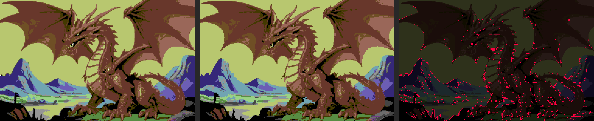

# vic2orious

Turns small pictures into Commodore 64 hires graphics that use far more colours per 8x8
cell than the hardware allows: every raster line, the 8 hardware sprites are recoloured
and moved to paint the pixels the bitmap cannot. Pictures can come with a short story,
drawn next to the image in a proportional version of the C64 font, or in a GEOS font.

## Example



A full screen (320x200) picture: the source in the C64 palette (left), what the C64
shows (middle, identical to VICE's output) and the pixels that differ (right, in red).
In this picture 2098 of 64000 pixels (3.3%) are wrong. Most are on lines that need more
than 8 single colour sprite spans; the rest are spans whose register writes did not fit
into the line's free cycles. Fewer colours and less fine detail per line get closer to
pixel perfect.

## Requirements

- Python 3 with [Pillow](https://pypi.org/project/pillow/)
- [cc65](https://cc65.github.io/) (`cl65`)
- [VICE](https://vice-emu.sourceforge.io/) (`x64sc`, `c1541`), installed with Homebrew
  (the build reads its palette and character ROM from `/opt/homebrew/share/vice/C64/`)

## 1. Prepare an image

Images must use the 16 C64 colours (Pepto or Colodore palette, or Colodore as VICE
shows it, which `tools/img2c64.py` writes; other colours go to the nearest Pepto colour),
with width and height multiples of 8
(up to the full screen, 320x200). Smaller and simpler images convert better; dithering hurts.

`tools/img2c64.py` turns any picture (anything Pillow reads; HEIC with `pillow-heif`)
into C64 input: it converts to sRGB, stretches the width for the system's pixel shape
(C64 pixels are about 0.94 as wide as tall on PAL TVs, 0.75 on NTSC), shrinks to fit
320x200 if needed, rounds both sides to multiples of 8 and maps to the palette:

```bash
python3 tools/img2c64.py photo.jpg -o input/name.png    # input/name-p.png, input/name-n.png
python3 tools/img2c64.py "pics/*.jpg" -o input/         # many, keeping their names
python3 tools/img2c64.py art.png -a none -o input/art.png   # as is, no stretch, no suffix
```

- `-a both` (default) writes a PAL (`-p`) and an NTSC (`-n`) version; `-a pal` or
  `-a ntsc` only one; `-a none` keeps the shape (for pixel art drawn at C64 size). The
  build treats `name-p.png` and `name-n.png` as image `name`: a PAL build uses
  `name-p.png` and an NTSC build `name-n.png`, each falling back to `name.png` (an error
  if that is missing too). The story and questions stay `name.txt` / `name.ask`.
- `-o` takes a file name (default `out.png`) or a directory (one that exists, or a path
  ending in `/`), where each picture keeps its name with a `.png` extension. Several
  inputs or a glob pattern need a directory.
- `-d none` turns off dithering. The default, `-d floydsteinberg`, often looks better on
  photos, but dithered images are harder to convert exactly, so try both.
- For a frame around the picture, don't draw one into the image: build with
  `make FRAME=1`, and the C64 draws it. Add `-b` here so the picture leaves room for it
  (it fits 304x184 instead of 320x200: one character cell on each side).

## 2. Add a story (optional)

Put the text in `input/<name>.txt`: paragraphs separated by blank lines, a first line
starting with `# ` becomes the title. It is wrapped to the space right of the image (or
below a very wide image); the build tells you if it does not fit.

### Fonts

By default the text uses a proportional font made from the C64's own character set. Any
GEOS font in Convert format (`.cvt`) works too: `make FONT=fonts/NLQ.cvt:12` uses its 12
point size (without `:12`, its smallest). This repository ships no fonts, as GEOS fonts
belong to their authors: get your own (GEOS disk archives and font collections have
plenty) and put them in `fonts/`, which git ignores. Big sizes take memory and screen
space: a 24 point font fits about 12 letters in the space beside a 128 pixel wide image.

## 3. Questions for the ask demo (optional)

`input/<name>.ask` turns the image into a small interactive scene: a menu of topics beside
the picture, picked with the number keys, each answered in text drawn while the picture
stays on screen. Format: a first line `# TITLE`, paragraphs introducing the scene, then
for each topic a line `> K label` (K is the key, 1-9) followed by the answer's paragraphs.
`input/princess.ask` is an example.

## 4. Build

```bash
make                                  # all images in input/
make IMAGES="input/a.png input/b.png" # or just these
make FRAME=1                          # frame the images (row 1, column 1)
make AT=2,3                           # place the images at character column 2, row 3
make -j8                              # convert up to 8 images at once
make convert                          # only convert the images (build/pal/<name>.v2i)
make verify                           # build and compare every screen with VICE
make clean
```

**NTSC:** images are built for PAL C64s by default. For an NTSC C64 (6567R8 VIC-II, the
usual one in North America) add `NTSC=1` to every make command (`make NTSC=1`,
`make run-diskshow NTSC=1`, ...): that build goes to `build/ntsc/` instead of `build/pal/`,
so PAL and NTSC builds can be kept side by side. An image only displays on the system it was built for; on the
other one the programs say so. NTSC images often convert a little better, as NTSC lines
are two cycles longer.

**Both on one disk:** `make DUAL=1` builds for both systems and writes
`build/dual/vic2orious.d81` (or `.d64` if it fits) with every image twice,
`<name>-p.v2i` and `<name>-n.v2i` (names cut to 10 characters), the stories once
(twice, `<name>-p.txt` and `<name>-n.txt`, when the two versions of an image differ in
size and the text sits differently beside them), and a
`diskshow` and `viewer` that detect the machine and load the matching files (in the
viewer, type the name without the ending). `v2i demo` holds both versions of its image
and shows the one for the machine (`build/dual/v2i-demo.prg`). The other programs with
images built in come in both versions: `slideshow-p`/`-n`, `ask <name>-p`/`-n`. The run
targets use this disk with `DUAL=1`, in NTSC VICE when you add `NTSC=1`. 24 images take
about 2,600 of the 3,160 blocks on a `.d81`.

Further options: `FONT=FILE.cvt[:SIZE]` (see Fonts above), `LEADING=n` (pixel lines
between text lines, default 2), `AUTO=n`
(frames per slideshow image, default 250; 0: only space changes the image) and
`HOLD=n` (seconds diskshow shows each image, default 15; 0: until space; diskshow turns
it into 50 or 60 frames a second for the machine it runs on) and
`DISK=d64|d81`. `make help` lists everything. The Makefile runs `python3 -m vic2.build`
(see `python3 -m vic2.build --help`) and rebuilds only when inputs or options change.

Each image is converted once. `build/pal/<name>.json` (`build/ntsc/` for NTSC) records
what the conversion depended on
(the image, the placement options, the converter sources), and later builds reuse the
`.v2i` while all that stays the same, so adding an image only converts that one. Stories
are laid out again on every build, so editing one, or changing `FONT` or `LEADING`,
converts nothing. `python3 -m vic2.build --force` converts everything again.

For every image the build prints how many lines and pixels could not be reproduced
exactly, and writes `build/pal/<name>_compare.png` (source | C64 result | wrong pixels in
red). Outputs, in `build/pal/` (or `build/ntsc/`):

- `slideshow.prg`: the images in one program; space for the next image, otherwise
  they change every 5 seconds. Only 3-4 images fit; with more, it takes the first ones
  that fit and says so.
- `diskshow.prg`: the same slideshow for any number of images, loading each one
  (and its story) from disk in turn and showing it for `HOLD` seconds (space: next).
  Loading uses the KERNAL, so it is slow (around half a minute per image with true drive
  emulation; `make run-diskshow FAST=1` loads instantly), and the image can't stay up
  meanwhile: the text screen says what is loading. RUN/STOP returns to BASIC.
- `ask-<name>.prg`: the ask demo for every image with an `.ask` file.
- `v2i-demo.prg`, `v2t-demo.prg`: the smallest programs using just one of the two
  libraries (an image; text without an image).
- `scroll-demo.prg`: every story on one tall page of text that scrolls smoothly, one
  pixel per frame (cursor down, cursor up or a joystick in port 2; space returns to
  BASIC). It uses the VIC's fine scroll and two bitmaps taking turns: v2t draws only the
  char row that scrolls in. Pages are up to 255 lines, as many as fit in memory.
- `stream-demo.prg`: the same stories arriving as a stream of plain ASCII text (3 bytes
  a frame), which the C64 wraps itself, word by word, into a ring of lines, scrolling
  smoothly as the newest line reaches the bottom. Space returns to BASIC.
- `vic2orious.d64`: disk with `viewer`, `diskshow`, `slideshow`, the demos, and every
  image and story as separate files. When they do not fit on a 1541 disk (about 13
  images) it is `vic2orious.d81` (1581, about 60 images) instead.

## 5. Watch

```bash
make run                              # the slideshow
make run-diskshow                     # the disk slideshow (all images)
make run-diskshow FAST=1              # same, with instant loading (also run-viewer, run-d64)
make run-viewer IMAGE=princess        # the disk viewer, with the image name typed in
make run-ask ASK=princess             # the ask demo
make run-v2i                          # image only
make run-v2t                          # text only
make run-scroll                       # smooth scrolling text
make run-stream                       # streamed text, wrapped and scrolled on the C64
make run-d64                          # boot the disk (.d64 or .d81; starts the viewer)
```

In the viewer, type an image name. Space returns to the prompt; an empty name quits. In
the ask demo, the number keys pick topics and space returns to BASIC.

## Using the images in your own program

The C64 side is two independent ca65 libraries:

- `asm/v2i.inc` shows a `.v2i` image and gives the machine back afterwards
  ([docs/v2i-lib.md](docs/v2i-lib.md), format: [docs/v2i-format.md](docs/v2i-format.md)).
- `asm/v2t.inc` draws `.v2t` text files and single lines of proportional text into any
  hires bitmap, also while an image is displayed ([docs/v2t-lib.md](docs/v2t-lib.md),
  format and font: [docs/v2t-format.md](docs/v2t-format.md)).

## License

Copyright 2026 Wes Biggs. Licensed under the [Apache License, Version 2.0](LICENSE).

The default font is generated at build time from the C64 character ROM that comes with
VICE; it is not part of this repository, and neither are GEOS fonts (see Fonts above).
