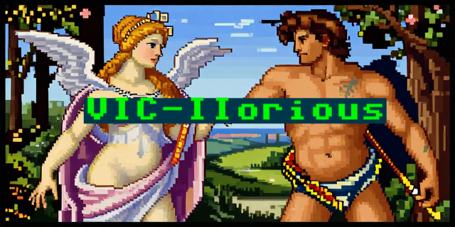
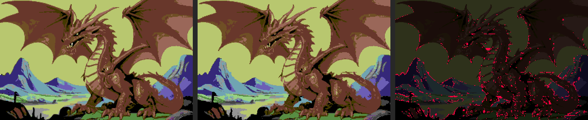
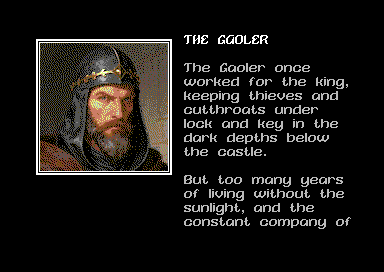
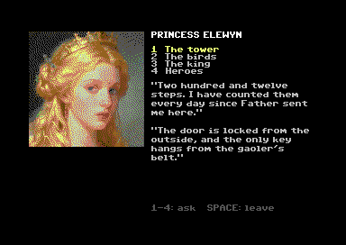

## Overview

`vic2orious` is a suite of formats, tools, and libraries for getting the most from the Commodore 64's VIC-II chip.

**Images**: Turn any source image into a Commodore 64 hi-res bitmap graphic (up to 320x200), using advanced sprite rasterization techniques that allow for far more colours per 8x8 cell than the standard mode allows, with minimal lossiness.

**Text**: Use widely available `.CVT` fonts as in GEOS to render crisp, variable-width text in any available point size. Combine text and images for jaw-dropping screens in your own games and programs.

`vic2orious` consists of:
- Python-based tooling to create `.v2i` image files and `.v2t` text files, as well as standalone C64 programs to display them in PAL, NTSC, or both
- Fully documented file formats for both images and text
- Assembly language libraries for developing your own programs with the renderers

## Image example



A full screen (320x200) picture: the source in the C64 palette (left), what the C64
shows (middle, identical to VICE's output) and the pixels that differ (right, in red).
In this picture, 2098 of 64000 pixels (3.3%) are wrong. Most are on lines that need more
than 8 single colour sprite spans; the rest occur where register writes did not fit
into the line's free cycles. Fewer colours and less fine detail per line (or narrower images)
get closer to pixel perfect.

## Requirements

- Python 3 with [Pillow](https://pypi.org/project/pillow/)
- [cc65](https://cc65.github.io/) (`cl65`)
- [VICE](https://vice-emu.sourceforge.io/) (`x64sc`, `c1541`), installed with Homebrew
  (by default, the build reads its palette and character ROM from `/opt/homebrew/share/vice/C64/`)

## 1. Prepare an image

Images must use the 16 C64 colours (Pepto or Colodore palette, or Colodore as VICE
shows it, which `tools/img2c64.py` writes; other colours go to the nearest Pepto colour),
with width and height multiples of 8
(up to the full screen, 320x200). Smaller and simpler images convert better; dithered images trade pixel perfection for perceptual accuracy.

`tools/img2c64.py` turns any picture (anything Pillow reads including HEIC with `pillow-heif`)
into C64 input: it converts to sRGB, stretches the width for the system's pixel shape
(C64 pixels are about 0.94 as wide as tall on PAL TVs, 0.75 on NTSC), shrinks to fit
320x200 (or less, configurable) if needed, rounds both sides to multiples of 8 and maps to the palette:

```bash
python3 tools/img2c64.py photo.jpg -o input/name.png    # input/name-p.png, input/name-n.png
python3 tools/img2c64.py "pics/*.jpg" -o input/         # many, keeping their names
python3 tools/img2c64.py art.png -a none -o input/art.png   # as is, no stretch, no suffix
```

- `-a both` (default) writes a PAL (`-p`) and an NTSC (`-n`) version; `-a pal` or
  `-a ntsc` only one; `-a none` keeps the shape (for pixel art drawn at C64 size). The
  build treats `name-p.png` and `name-n.png` as image `name`: a PAL build uses
  `name-p.png` and an NTSC build `name-n.png`, each falling back to `name.png` (an error
  if that is missing too). The story and questions stay `name.txt` / `name.ask`.
- `-o` takes a file name (default `out.png`) or a directory (one that exists, or a path
  ending in `/`), where each picture keeps its name with a `.png` extension. Several
  inputs or a glob pattern need a directory.
- `-d` picks the dithering. Without it, img2c64 picks one per picture and system: it
  tries the modes below (none, fs, fs:0.75, fs:0.5, atkinson, atkinson:0.75 and hybrid
  with three line budgets), runs each result through the converter, and keeps the one
  whose C64 picture is closest to the source (blurred SSIM and colour error), printing
  its pick and the runners-up. That takes about 50 s per picture and system on a 12-core
  machine; `-w R,S,C` changes the weights of blurred RMS, SSIM and colour error (default
  `0,1,1`; see `analysis/README.md`). `-d floydsteinberg` (`fs`) often looks lively on
  photos, but its scattered pixels are hard to convert exactly (often 10-15% wrong);
  `-d none` converts almost exactly but looks flat. In between:
  - `-d hybrid[:E]` dithers each 8x8 cell between its best pair of colours, and only
    leaves them where the pair is more than E (default 90; lower: more colours and
    more wrong pixels) off. The best trade on photos, especially with `-c 0.6`.
  - `-d fs:K` passes on only K (0-1) of the error, e.g. `fs:0.5`.
  - `-d atkinson[:K]`, Atkinson's dither (flatter midtones), e.g. `atkinson:0.75`.

  On a 320x168 photo: Floyd-Steinberg 15% wrong pixels, `fs:0.5` 4%, `atkinson:0.75`
  5%, `hybrid` 3%, `hybrid -c 0.6` 2%, none 0.2%.
- `-l N|none` (with `-d hybrid`) is a budget per line: the colours outside each cell's
  pair have to fit in N runs of 24 pixels (default 8, one per sprite); a pixel needing
  more takes the nearest colour that fits. It makes the C64 show the picture almost
  exactly, but where many pixels hit it (stone, foliage), whole areas can fall to grey;
  `-l none` turns it off (more wrong pixels, fuller colour).
- `-c S` chooses the colours as if the palette had S times its saturation (the output
  keeps the real colours). The C64's colours are far more saturated than most photos,
  so at 1 their browns, reds and blues fall to grey. With `-d hybrid`, `-c 0.6` gives
  warmer colours and fewer wrong pixels; with the other modes it adds wrong pixels.
- `-P FILE.vpl` uses the palette of your screen, e.g. one measured from a photo of your
  TV running a colour bar: colours are chosen as it shows them, and the PNG is written
  in its colours, so it looks on your computer roughly as on the TV. The default,
  `tools/tv.vpl`, was measured from the author's TV, which is much paler than VICE's
  Colodore; it keeps backgrounds from going grey there. `-P none` uses VICE's Colodore
  (what VICE shows by default). The build only reads PNGs in palettes it knows
  (`vic2/palette.py`: Pepto, Colodore, VICE's Colodore, `tools/tv.vpl`); add yours there.
- For a frame around the picture, don't draw one into the image: build with
  `make FRAME=1`, and the C64 draws it. Add `-b` here so the picture leaves room for it
  (it fits 304x184 instead of 320x200: one character cell on each side).
- `-s WxH` fits the picture into a smaller box, e.g. `-s 160x96` (multiples of 8). The
  aspect stretch still applies, so the PAL and NTSC versions can differ in size.
- `-m` makes a multicolour picture: half the horizontal resolution (pixels two screen
  pixels wide, 160 across), but three colours per cell plus black, so the converter
  shows nearly every pixel even with full Floyd-Steinberg dithering (hires loses about
  10% of those). The PNG is 160 wide and says so in its settings; the build makes a
  multicolour `.v2i` from it, centred, without text or frame. Not with `-d hybrid`.

### One picture, one PRG

Python's `vic2.prg` runs the whole pipeline for a single picture: img2c64 as above, `.v2i` image generation, and wrapping into a single PRG output file that renders on a real C64 (or VICE).
 
Defaults are: both aspects, the `tools/tv.vpl` palette, no frame; the dither img2c64 picks, maximum width of 320 and height of 200, centred horizontally and vertically.
Run without arguments or pass `-h` for a detailed list of options.

```bash
python3 -m vic2.prg /path/to/my_image.png               # my_image.prg in this directory
python3 -m vic2.prg photo.jpg -o out/photo.prg --verify  # check both in VICE
python3 -m vic2.prg logo.png -d none -s 160x96          # no dithering, at most 160x96
python3 -m vic2.prg photo.jpg -d hybrid -c 0.6          # fewer wrong pixels on photos
make prg PIC=/path/to/my_image.png                       # the same as the first
make prg PIC=logo.png DITHER=none SIZE=160x96            # and the third
make prg PIC=photo.jpg DITHER=hybrid CHROMA=0.6           # and the fourth
make prg PIC=photo.jpg DITHER=hybrid LINES=none           # hybrid without its line budget
```

Generated files go to `build/prg/` (`<name>-p.png` and `<name>-n.png` are 16-color target images, and the conversions are placed in
`pal/` and `ntsc/`.
`--run` (or `--run ntsc`) starts the generated program in VICE. Both images have to fit in one PRG
(`$0801-$bfff`, about 46K together). Testing against a variety of images of differing types has not yet caused this to be exceeded, but it is theoretically possible; the converter will complain, and the workaround is to generate separate NTSC and PAL versions.

## 2. Add text (optional)



Put the text in `input/<name>.txt`: paragraphs separated by blank lines, a first line
starting with `# ` becomes the title. It is wrapped to fit the space to the right of the image (or
below a very wide image); the build tells you if it does not fit.

### Fonts

By default the text uses a proportional font made from the C64's own character set. Any
GEOS font in Convert format (`.cvt`) works too: `make FONT=fonts/NLQ.cvt:12` uses its 12
point size (without `:12`, its smallest). This repository ships no fonts, as GEOS fonts
belong to their authors: get your own (GEOS disk archives and font collections have
plenty) and put them in `fonts/`, which git ignores. Big sizes take memory and screen
space: a 24 point font fits about 12 letters in the space beside a 128 pixel wide image.

## 3. Build an interactive demo (optional)



`input/<name>.ask` turns the image into a small interactive scene: a menu of topics beside
the picture, picked with the number keys, each answered in text drawn while the picture
stays on screen. Format: a first line `# TITLE`, paragraphs introducing the scene, then
for each topic a line `> K label` (K is the key, 1-9) followed by the answer's paragraphs.
`input/princess.ask` is an example.

## 4. Batch processing and slideshows

```bash
make                                  # all images in input/
make IMAGES="input/a.png input/b.png" # or just these
make FRAME=1                          # frame the images (with a text: at row 1, column 1)
make AT=2,3                           # place the images at character column 2, row 3
make -j8                              # convert up to 8 images at once
make convert                          # only convert the images (build/pal/<name>.v2i)
make verify                           # build and compare every screen with VICE
make clean
```

**NTSC:** images are built for PAL C64s by default. For an NTSC C64 (6567R8 VIC-II, the
usual one in North America) add `NTSC=1` to every make command (`make NTSC=1`,
`make run-diskshow NTSC=1`, ...): that build goes to `build/ntsc/` instead of `build/pal/`,
so PAL and NTSC builds can be kept side by side. An image only displays on the system it was built for; on the
other one the programs say so. NTSC images often convert a little better, as NTSC lines
are two cycles longer.

**Both on one disk:** `make DUAL=1` builds for both systems and writes
`build/dual/vic2orious.d81` (or `.d64` if it fits) with every image twice,
`<name>-p.v2i` and `<name>-n.v2i` (names cut to 10 characters), the stories once
(twice, `<name>-p.txt` and `<name>-n.txt`, when the two versions of an image differ in
size and the text sits differently beside them), and a
`diskshow` and `viewer` that detect the machine and load the matching files (in the
viewer, type the name without the ending). `v2i demo` holds both versions of its image
and shows the one for the machine (`build/dual/v2i-demo.prg`). The other programs with
images built in come in both versions: `slideshow-p`/`-n`, `ask <name>-p`/`-n`. The run
targets use this disk with `DUAL=1`, in NTSC VICE when you add `NTSC=1`. 24 images take
about 2,600 of the 3,160 blocks on a `.d81`.

Further options: `FONT=FILE.cvt[:SIZE]` (see Fonts above), `LEADING=n` (pixel lines
between text lines, default 2), `AUTO=n`
(frames per slideshow image, default 250; 0: only space changes the image) and
`HOLD=n` (seconds diskshow shows each image, default 10; 0: until space; diskshow turns
it into 50 or 60 frames a second for the machine it runs on) and
`DISK=d64|d81`. `make help` lists everything. The Makefile runs `python3 -m vic2.build`
(see `python3 -m vic2.build --help`) and rebuilds only when inputs or options change.

Each image is converted once. `build/pal/<name>.json` (`build/ntsc/` for NTSC) records
what the conversion depended on
(the image, the placement options, the converter sources), and later builds reuse the
`.v2i` while all that stays the same, so adding an image only converts that one. Stories
are laid out again on every build, so editing one, or changing `FONT` or `LEADING`,
converts nothing. `python3 -m vic2.build --force` converts everything again.

Images with a story or an `.ask` sit at the upper left, leaving the rest of the screen
for the text; images without one are centred, and so is the image in `v2i-demo.prg`
(the first image, converted a second time if it has a story). `AT` places all of them.

For every image the build prints how many lines and pixels could not be reproduced
exactly, and writes `build/pal/<name>_compare.png` (source | C64 result | wrong pixels in
red) and `build/pal/<name>_sprites.png`, which shows how the sprites are used (top:
the bitmap alone, the sprite pixels alone; bottom: each sprite's 24 pixel windows in its
own colour, bright where it paints, and a heat map of sprite pixels per cell with the
sprites painting on each line beside it, red ticks for lines that are not exact; see
`vic2/layers.py`). Both are written when an image is converted, not when the build
reuses a cached conversion (`--force` converts again). Outputs, in `build/pal/` (or
`build/ntsc/`):

- `slideshow.prg`: the images in one program; space for the next image, otherwise
  they change every 5 seconds. Only 3-4 images fit; with more, it takes the first ones
  that fit and says so.
- `diskshow.prg`: the same slideshow for any number of images, loading each one
  (and its story) from disk in turn and showing it for `HOLD` seconds (space: next).
  Loading uses the KERNAL, so it is slow (around half a minute per image with true drive
  emulation; `make run-diskshow FAST=1` loads instantly), and the image can't stay up
  meanwhile: the screen shows a yellow floppy disk on black (the text screen comes back only to
  show a load error). RUN/STOP returns to BASIC.
- `ask-<name>.prg`: the ask demo for every image with an `.ask` file.
- `v2i-demo.prg`, `v2t-demo.prg`: the smallest programs using just one of the two
  libraries (an image; text without an image).
- `scroll-demo.prg`: every story on one tall page of text that scrolls smoothly, one
  pixel per frame (cursor down, cursor up or a joystick in port 2; space returns to
  BASIC). It uses the VIC's fine scroll and two bitmaps taking turns: v2t draws only the
  char row that scrolls in. Pages are up to 255 lines, as many as fit in memory.
- `stream-demo.prg`: the same stories arriving as a stream of plain ASCII text (3 bytes
  a frame), which the C64 wraps itself, word by word, into a ring of lines, scrolling
  smoothly as the newest line reaches the bottom. Space returns to BASIC.
- `vic2orious.d64`: disk with `viewer`, `diskshow`, `slideshow`, the demos, and every
  image and story as separate files. When they do not fit on a 1541 disk (about 13
  images) it is `vic2orious.d81` (1581, about 60 images) instead.

## 5. Watch

```bash
make run                              # the slideshow
make run-diskshow                     # the disk slideshow (all images)
make run-diskshow FAST=1              # same, with instant loading (also run-viewer, run-d64)
make run-viewer IMAGE=princess        # the disk viewer, with the image name typed in
make run-ask ASK=princess             # the ask demo
make run-v2i                          # image only
make run-v2t                          # text only
make run-scroll                       # smooth scrolling text
make run-stream                       # streamed text, wrapped and scrolled on the C64
make run-d64                          # boot the disk (.d64 or .d81; starts the viewer)
```

In the viewer, type an image name. Space returns to the prompt; an empty name quits. In
the ask demo, the number keys pick topics and space returns to BASIC.

## Using the images in your own program

The C64 side is two independent ca65 libraries:

- `asm/v2i.inc` shows a `.v2i` image and gives the machine back afterwards
  ([docs/v2i-lib.md](docs/v2i-lib.md), format: [docs/v2i-format.md](docs/v2i-format.md)).
- `asm/v2t.inc` draws `.v2t` text files and single lines of proportional text into any
  hires bitmap, also while an image is displayed ([docs/v2t-lib.md](docs/v2t-lib.md),
  format and font: [docs/v2t-format.md](docs/v2t-format.md)).

## License

Copyright 2026 Wes Biggs. Licensed under the [Apache License, Version 2.0](LICENSE).

The default font is generated at build time from the C64 character ROM that comes from
VICE or your own machine; it is not part of this repository, and neither are GEOS fonts (see Fonts above).
